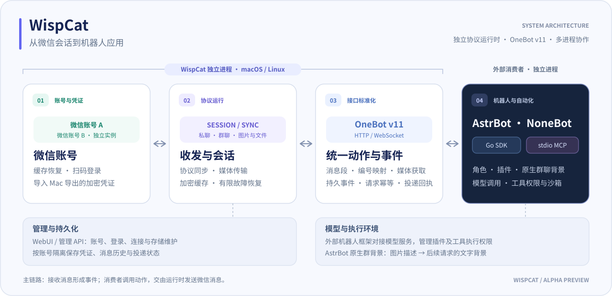
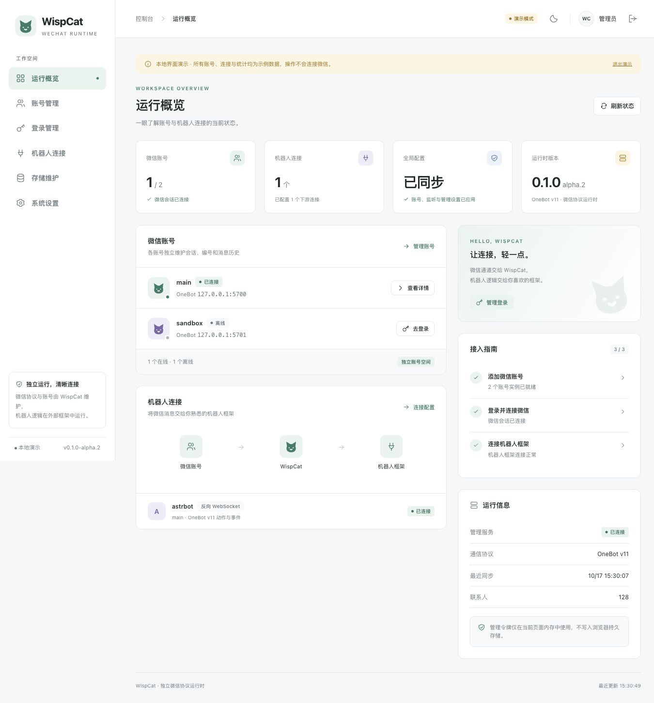
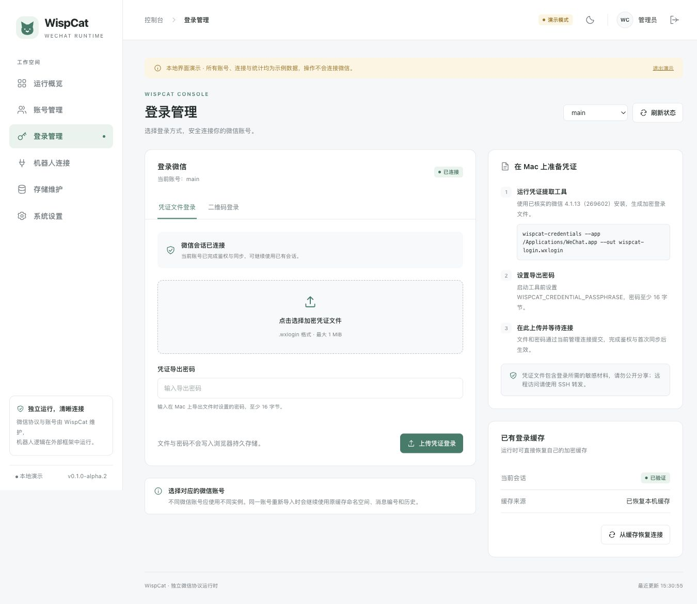
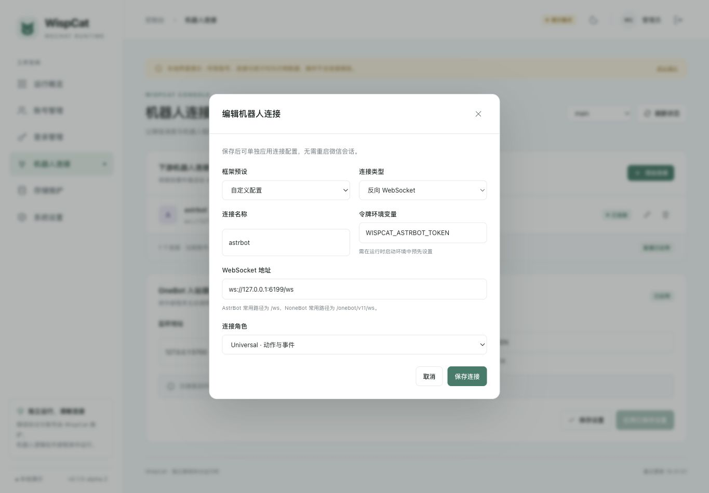
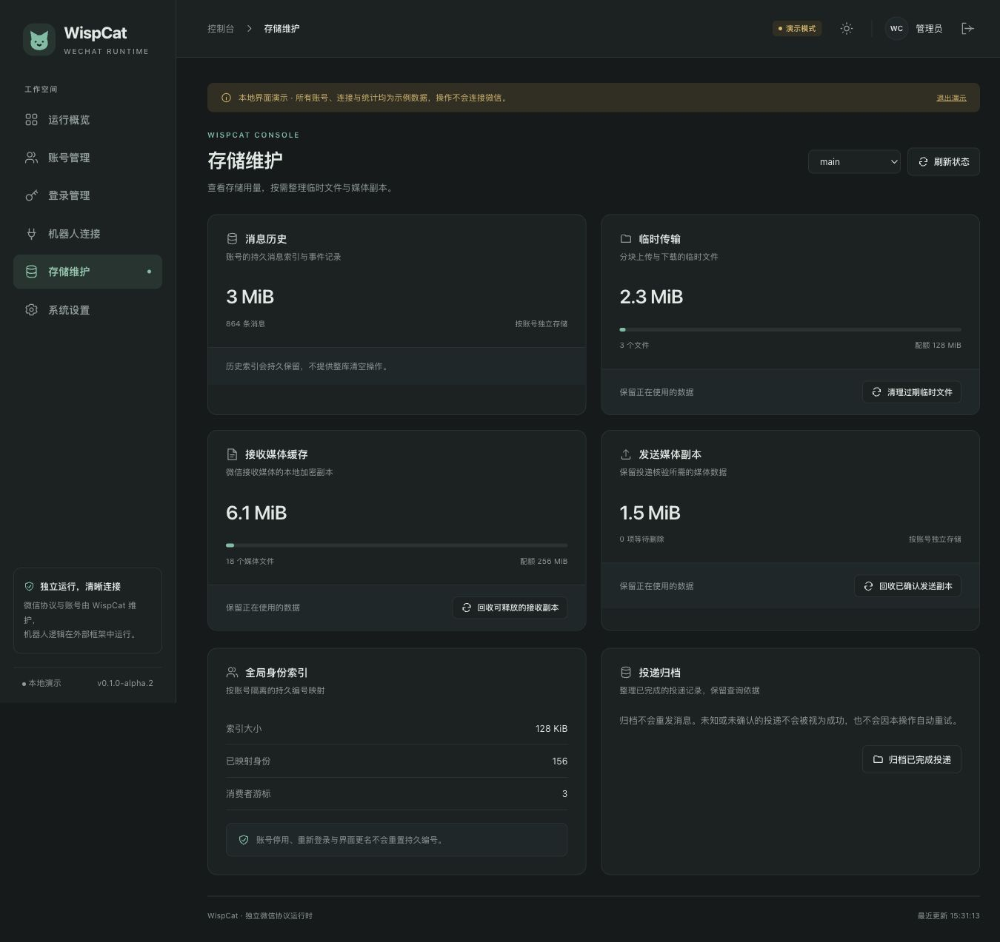

<h1 align="center">WispCat</h1>

<p align="center">独立微信协议运行时 · OneBot v11 · WebUI · Go SDK · MCP · Alpha 开发预览</p>
<p align="center">
  <a href="#下载发行包">下载</a> ·
  <a href="#架构与运行链路">架构</a> ·
  <a href="#管理界面">界面预览</a> ·
  <a href="#快速开始">快速开始</a> ·
  <a href="docs/usage.md">完整使用指南</a> ·
  <a href="#登录与凭证迁移">登录与凭证迁移</a> ·
  <a href="#接入机器人">接入机器人</a> ·
  <a href="#授权与免责声明">授权与免责声明</a>
</p>

WispCat 将微信协议与机器人业务分开：由独立进程维护账号、登录、消息同步和媒体传输，
将消息转换为 OneBot 动作与事件，供 NoneBot、AstrBot 或自定义程序调用。
模型、插件、角色和工具权限由外部机器人框架管理。

> **本仓库仅供学习与研究。未经仓库主作者明确授权，禁止任何项目基于 WispCat 的原创代码进行开发。使用时须遵守适用法律法规及相关平台规则；违法违规使用及传播违规使用教程所产生的责任，由相关行为人依法承担。**
>
> WispCat 是非官方项目，与腾讯、微信没有隶属、合作或背书关系。使用前请阅读文末的[授权与免责声明](#授权与免责声明)。

## 功能概览

| 能力 | 当前支持 |
| --- | --- |
| 微信通道 | 独立维护账号、会话、消息同步和加密缓存；最多 16 个账号 |
| 消息与媒体 | 私聊、群聊、文本、@、图片与文件；按账号隔离编号及历史 |
| OneBot v11 | HTTP 动作、正向／反向 WebSocket、HTTP 事件上报，以及 `wechat_*` 扩展 |
| 管理页面 | 账号状态、加密凭证上传登录、监听与下游连接配置、账号成员管理 |
| 可靠性接口 | 请求幂等、投递回执、按请求查询投递结果、持久事件编号 |
| 外部接入 | Go SDK、独立消费者示例、可按读写权限配置的 stdio MCP 服务 |

**最近公开发行版为 `v0.1.0-alpha.2`（Alpha 开发预览）。** `main` 还包含该版之后的恢复与诊断修复；
本文的有限重试、`connection.last_error` 等说明以当前 `main` 为准，旧发行包的能力请同时核对 Release 说明。
已完成 macOS／Linux 的离线检查，并在 Linux 上验证过缓存恢复登录、
消息同步和 AstrBot 对接。开发检查使用合成账号与回环服务；这些结果不代表长期稳定性、
全部微信功能或完整 OneBot 标准均已验证。

目前采用 macOS 微信 4.1.13 的兼容协议身份。macOS 与 Linux 可运行；原生 Windows 尚未适配。
联系人和群成员接口返回已观察到的资料；引用／撤回、语音视频、完整群成员列表和群管理尚未实现。
不支持的操作会明确拒绝。图片传输与模型识图是两层能力，实际效果还取决于下游框架和模型；
真实微信图片到模型再回复的完整链路尚未完成验收。

## 架构与运行链路

[](assets/readme/architecture.svg)

WispCat 独立维护微信账号与协议，通过 OneBot 向外提供动作、事件和媒体获取。
管理页面负责运行时配置，AstrBot／NoneBot 等消费者负责群聊背景、模型、角色、插件和工具权限。
多个账号分别保存登录缓存、历史和投递状态；消费者可以独立启动、升级或更换。

布局参考 [SnowLuma 的运行链路图](https://github.com/SnowLuma/SnowLuma/blob/87527cb7641a5a42f8f0efb73cb066102e004dee/assets/readme/runtime-map.svg)，
图中组件按 WispCat 实际职责重新绘制。[SVG 图源](assets/readme/architecture.svg) · [Mermaid 结构源](assets/readme/architecture.mmd)。

## 管理界面

截图来自内置演示模式，账号、连接、统计均为示例数据，不含真实登录凭证或聊天记录。点击图片可查看大图。

| 运行概览 | 登录管理 |
| --- | --- |
| [](assets/readme/overview.jpg) | [](assets/readme/login.jpg) |
| **机器人连接表单** | **存储维护与深色主题** |
| [](assets/readme/connections.jpg) | [](assets/readme/storage-dark.jpg) |

## 快速开始

首次使用建议配合[完整使用指南](docs/usage.md)：包含持久保存令牌、配置字段解释、
Mac → Linux 凭证迁移、AstrBot／NoneBot 接入、管理页保存与应用、多账号、备份升级和故障排查。

### 下载发行包

从 [Releases](https://github.com/JFSAS/WispCat/releases) 下载匹配系统和 CPU 架构的包。
当前可执行发行版为 `v0.1.0-alpha.2`；Windows 暂不提供。

| 系统与架构 | 下载 | 运行要求 |
| --- | --- | --- |
| macOS Apple Silicon（M1 / M2 / M3 / M4 等） | [darwin_arm64.tar.gz](https://github.com/JFSAS/WispCat/releases/download/v0.1.0-alpha.2/wispcat_v0.1.0-alpha.2_darwin_arm64.tar.gz) | macOS 15+ |
| macOS Intel | [darwin_amd64.tar.gz](https://github.com/JFSAS/WispCat/releases/download/v0.1.0-alpha.2/wispcat_v0.1.0-alpha.2_darwin_amd64.tar.gz) | macOS 15+ |
| Linux x64（`x86_64`） | [linux_amd64.tar.gz](https://github.com/JFSAS/WispCat/releases/download/v0.1.0-alpha.2/wispcat_v0.1.0-alpha.2_linux_amd64.tar.gz) | glibc 2.35+，如 Ubuntu 22.04 / Debian 12 及更新版本 |
| Linux ARM64（`aarch64`） | [linux_arm64.tar.gz](https://github.com/JFSAS/WispCat/releases/download/v0.1.0-alpha.2/wispcat_v0.1.0-alpha.2_linux_arm64.tar.gz) | glibc 2.35+ |

下载同版 [SHA256SUMS](https://github.com/JFSAS/WispCat/releases/download/v0.1.0-alpha.2/SHA256SUMS)，
在下载目录按文件名选择对应行，再校验。以下以 Apple Silicon 包为例；替换为你实际下载的文件名，
Linux 将 `shasum -a 256 -c -` 换为 `sha256sum -c -`：

```sh
grep 'wispcat_v0.1.0-alpha.2_darwin_arm64.tar.gz$' SHA256SUMS | shasum -a 256 -c -
```

对应文件应显示 `OK`。

解压后进入包内目录，保持可执行文件与 `lib/` 在同一目录层级。发行包内置管理前端和 OpenSSL；
Linux 包另带 SQLite，macOS 使用系统 SQLite。运行时无需安装 Go、Node.js、Homebrew 或开发库。
macOS 文件使用 ad-hoc 签名，尚未 Apple 公证；首次运行可能需要按系统安全提示由用户确认。

```sh
# 在解压得到的目录中执行
cp wispcat.example.json wispcat.local.json
export WISPCAT_ADMIN_TOKEN="$(od -An -N32 -tx1 /dev/urandom | tr -d ' \n')"
export WISPCAT_ONEBOT_TOKEN="$(od -An -N32 -tx1 /dev/urandom | tr -d ' \n')"
export WISPCAT_BOT_TOKEN="$(od -An -N32 -tx1 /dev/urandom | tr -d ' \n')"
export WISPCAT_ASTRBOT_TOKEN="$(od -An -N32 -tx1 /dev/urandom | tr -d ' \n')"
./wispcat check --config wispcat.local.json
printf '管理令牌：%s\n' "$WISPCAT_ADMIN_TOKEN"
./wispcat serve --config wispcat.local.json
```

打开 `http://127.0.0.1:5099/`，输入上方管理令牌。默认示例账号为离线状态；
将令牌保存到你的私有启动环境，配置下游时同步对应令牌。
需要跨终端或重启保留令牌时，按[指南中的环境文件示例](docs/usage.md#2-保存启动令牌)设置。
macOS 包另含 `wispcat-credentials`，可按下方说明提取 Mac 凭证；Linux 通过管理页上传加密文件登录。

### 从源码构建

需要 Go 1.25+、C 编译器、OpenSSL 3 和 SQLite 3 的开发库。
macOS 的构建脚本使用 Homebrew `openssl@3`；Linux 还需准备 `pkg-config`。
从仓库获取本版源码后构建：

```sh
git clone https://github.com/JFSAS/WispCat.git
cd WispCat
```

```sh
sh tools/go.sh build -o .bin/wispcat ./cmd/wispcat
sh tools/go.sh build -o .bin/wispcat-mcp ./cmd/wispcat-mcp
cp wispcat.example.json wispcat.local.json

# 分别生成独立随机令牌。示例反向连接的令牌须与下游框架一致。
export WISPCAT_ADMIN_TOKEN="$(openssl rand -hex 32)"
export WISPCAT_ONEBOT_TOKEN="$(openssl rand -hex 32)"
export WISPCAT_BOT_TOKEN="$(openssl rand -hex 32)"
export WISPCAT_ASTRBOT_TOKEN="$(openssl rand -hex 32)"
./.bin/wispcat check --config wispcat.local.json
./.bin/wispcat serve --config wispcat.local.json
```

示例管理页为 `http://127.0.0.1:5099/`，OneBot 为 `http://127.0.0.1:5700`。
在管理页输入 `WISPCAT_ADMIN_TOKEN` 的值，点击“进入控制台”。管理令牌相当于后台访问密码，
与微信登录凭证不同；令牌需在私有环境中妥善保存，
重新生成或更换令牌时应同步调整消费者配置。

示例账号默认 `offline`。连接微信前，先配置实际账号实例及登录凭证，再明确设为 `online`；
单纯启动离线示例不会登录微信。多个账号分别配置 `instance`、监听端口、令牌和下游连接。
同一状态目录只能由一个进程持有；备份前正常停止进程，完整保留状态目录及密钥。

Dockerfile 使用非 root 用户，入口为 `wispcat`，配置路径为 `/config/runtime.json`，
状态目录应持久挂载。服务监听限定回环；Linux Docker 可按环境使用 host networking，
单独发布端口不能访问容器的回环地址。

## 登录与凭证迁移

### 在 Mac 导出

`wispcat-credentials` 复用协议来源项目的磁盘读取、安装指纹和完整性校验，
目前支持已核实的微信 **4.1.13（269602）**。工具只生成加密文件，不连接微信。
使用 macOS 发行包时，在解压后的目录用默认 zsh 执行：

```zsh
read -rs 'WISPCAT_CREDENTIAL_PASSPHRASE?导出密码（至少16字节）：'
echo
export WISPCAT_CREDENTIAL_PASSPHRASE
./wispcat-credentials --app /Applications/WeChat.app --out ~/Desktop/wispcat-login.wxlogin
unset WISPCAT_CREDENTIAL_PASSPHRASE
```

从源码运行时，先执行 `sh tools/go.sh build -o .bin/wispcat-credentials ./cmd/wispcat-credentials`，
再将上方的 `./wispcat-credentials` 换为 `./.bin/wispcat-credentials`。

其他微信安装可修改 `--app`；`--passphrase-env` 可指定密码环境变量。
输出文件权限为 `0600`，拒绝覆盖同名文件。文件最多 1 MiB，使用 AES-256-GCM 加密，
密码经 PBKDF2-SHA256（600,000 次）派生；不包含运行时私有缓存的密钥。

### 在 Linux 上传登录

通过 SSH 转发访问 Linux 的回环管理端口：

```sh
ssh -N -L 127.0.0.1:5099:127.0.0.1:5099 user@linux-host
```

在 Mac 打开 `http://127.0.0.1:5099/`，输入管理令牌进入控制台，在“登录管理”中选择目标账号，
通过“凭证文件登录”选择 `.wxlogin` 文件，输入导出密码，点击“上传凭证登录”。
转发两端使用相同端口，浏览器地址使用 `127.0.0.1`，以通过管理接口的 Host 校验。

上传成功表示请求已接受；完成微信鉴权与首次同步后才显示“已连接”。失败时显示错误类别，
不自动反复鉴权。同账号重新导入会保留原缓存命名空间、编号和历史；不同微信账号应使用不同实例。
登录成功后由运行时自己的加密缓存恢复。管理页不会把凭证文件或解密密码写入浏览器持久存储。

## 故障恢复与日志

网络故障最多重试 6 次，退避间隔上限 30 秒；HTTP 响应截断归为网络错误。
已验证会话的同步响应格式异常最多重试 2 次，保持原同步位置，不因此重新登录。
账号不匹配、完整性验证失败和 TLS 证书校验失败立即停止。
保存失败最多重试当前批次 3 次（间隔 1、2、4 秒），期间暂停新的同步与发送；
达到上限后保留缓存并显示“需要处理”。每轮自动恢复最多发起 3 次鉴权请求，
明确的鉴权拒绝立即停止；只有完成同步和持久化，或用户明确恢复上线，才重置该轮计数。

标准错误日志中的 `wechat_runtime_failure` 包含 `class`、`operation`、`stage`、`reason`、
`code`、`retries`、`retry_limit`、`decision` 和下次重试时间。
管理状态的 `connection.last_error` 提供相同的诊断字段；日志不记录原始响应、消息正文、
凭证或本机私有路径。处理磁盘、网络或协议问题后，可在管理页恢复上线；不会自动无限登录。

## 接入机器人

逐步操作见[接入 AstrBot](docs/usage.md#接入-astrbot)和[接入 NoneBot](docs/usage.md#接入-nonebot)。

`wispcat.example.json` 中的 `reverse[].url` 指向机器人框架的反向 WebSocket 地址，
`token_env` 指定保存下游令牌的环境变量。常见配置如下，实际端口与令牌以框架设置为准：

| 外部程序 | 示例地址 | 说明 |
| --- | --- | --- |
| NoneBot + OneBot v11 适配器 | `ws://127.0.0.1:8080/onebot/v11/ws` | 启用 OneBot v11 适配器并配置访问令牌 |
| AstrBot + aiocqhttp 平台 | `ws://127.0.0.1:6199/ws` | 路径为 `/ws`，与 NoneBot 示例不同 |
| 自定义程序 | OneBot HTTP 或正向 WebSocket | 可参考 [Go 消费者示例](examples/echo/main.go) |

`Universal` 连接同时承载动作与事件，握手包含 `X-Self-ID`、`X-Client-Role` 和 Bearer token。
HTTP 动作支持 GET、JSON POST 和表单；正向 WebSocket 支持 `/`、`/api`、`/event`。
使用 OneBot 令牌访问 `/_actions` 查看动作与参数，访问 `/_connections` 查看连接状态。

```json
{"action":"send_private_msg","params":{"user_id":10001,"message":"hello","wechat_request_id":"my-request-id"},"echo":"request-1"}
```

数字 ID 是持久、按账号隔离的映射，不是微信号；`echo` 仅关联响应。
发送重试应复用持久保存的 `wechat_request_id`：同键同内容返回原投递，内容冲突会失败。
排队、超时和未知结果不等于可以重新发送；先用 `wechat_get_delivery_by_request` 查询原请求。
事件消费者使用 `wechat_event_id` 去重，WebSocket 写入成功不代表业务处理完成。

图片／文件支持 base64、HTTP(S) URL 和 `stream://` 引用，不接受任意本机路径。
混合发送最多拆成 20 条原生消息，媒体合计最多 16 MiB；上传／下载单块最多 256 KiB。
临时引用按账号隔离，不跨进程重启保留。

群聊使用 AstrBot 原生流程，无需修改 AstrBot 源码。以已验证的 AstrBot 4.29.0 为例，
在 AstrBot 中开启群聊上下文（`provider_ltm_settings.group_icl_enable`），
将 `group_message_max_cnt` 设为 1000，并开启 `platform_settings.ignore_at_all`。
需要理解此前图片时，开启 `image_caption` 并指定支持图片的 `image_caption_provider_id`；
原生流程在图片到达时生成描述，再把描述附到后续模型请求的文字背景中。

原生唤醒支持直接 @、引用机器人消息、唤醒前缀和插件命令；群聊背景按模型请求边界消费，
这版原生背景缓存在内存中。单独一个 @ 默认进入等待后续内容的流程。
主动回复、工具权限、沙箱、角色、模型和联网搜索均在 AstrBot 中管理。

## Go SDK 与 MCP

[`pkg/bot`](pkg/bot/) 定义通道接口，[`pkg/client`](pkg/client/) 提供外部 Go 客户端。
SDK 支持动作、事件、上传和下载，下载校验完整字节及 SHA256，不自动重试发送。
Go 模块路径为 `github.com/JFSAS/wispcat`。

`wispcat-mcp` 通过标准输入／输出提供 MCP 接口。未设置端点时默认为 `docs`；
只设置端点而未指定模式时默认 `read`。写动作和本地文件处理须显式选择 `write`。

| 环境变量 | 用途 |
| --- | --- |
| `WISPCAT_MCP_ENDPOINT` | OneBot HTTP 地址 |
| `WISPCAT_MCP_TOKEN` | OneBot 令牌 |
| `WISPCAT_MCP_MODE` | `docs`、`read` 或 `write` |
| `WISPCAT_MCP_UPLOAD_ROOT` | 允许上传的本地目录 |
| `WISPCAT_MCP_STREAM_DIR` | 下载文件私有目录；默认使用进程私有临时目录 |

目录工具为 `list_actions`、`get_action`、`search_actions`、`list_categories`。
工具请求最多并行 8 个，本地文件操作串行；取消不能撤销已提交的发送或文件副作用。

## 管理与开发

管理页面使用 React + TypeScript + Vite，提供账号状态面板、登录引导与连接表单；构建产物通过 Go `embed` 内嵌，运行时不需要 Node.js。
管理页面和管理 API 使用独立管理令牌，配置保存与应用分开。
`/accounts`、`/storage` 提供账号与存储状态；`/configuration` 保存整份期望配置，
各设置的 `/apply` 端点负责应用。整份持久化不等于统一热激活或失败回滚。
凭证上传端点为 `POST /accounts/<name>/login/import`，multipart 字段为 `file` 与 `passphrase`，
接受后返回 202，通过账号状态查看实际鉴权结果。

仓库包含可直接用于 Go 构建的前端产物。界面开发需要 Node.js 24+。修改界面后，在 `webui/` 中执行 `npm ci`、`npm run build`，再重新构建 Go 程序；`npm run dev` 可用 `?demo=1` 进行独立界面开发。演示模式仅使用浏览器内的示例数据，不调用微信或管理 API。

首版验收范围固定为：构建与离线启动、账号登录与缓存恢复、文本收发、群聊 @ 处理、
OneBot／AstrBot 对接及管理表单。真实账号的在线验收与离线 CI 分开；CI 不登录微信、
不调用模型、不需要真实凭证，也不代表全部兼容性已验证。

GitHub Actions 的最小检查会重建前端并检查产物一致性，编译全部 Go 包、运行重点回归，
再用两个合成离线账号验证实际程序的启动与正常退出。依赖先在联网阶段准备，Go 回归在
仅允许回环网络的环境中执行。

依赖准备完成后，macOS 可执行与 CI 同范围的检查：

```sh
npm ci --prefix webui
npm test --prefix webui
npm run build --prefix webui
go mod download
sh tools/alpha-checks.sh
```

Linux 执行 `tools/alpha-checks.sh` 前需进入仅有已启用回环接口的网络命名空间，
可参考 [CI 工作流](.github/workflows/alpha.yml)。按具体改动需要，还可运行：

```sh
sh tools/offline-checks.sh
python3 tools/check_baseline.py --source /path/to/original/rea
sh tools/mcp-offline-checks.sh
# 准备相应 Python 环境后，按需执行框架与部署检查
sh tools/framework-offline-checks.sh nonebot aiocqhttp
sh tools/deployment-offline-checks.sh --media nonebot
```

检查使用合成账号与回环服务。macOS 脚本使用 `sandbox-exec`，Linux 需只有回环的网络命名空间。
依赖环境、执行结果和临时文件放在被 Git 忽略的 `.bin/` 中；真实令牌、凭证、状态目录和聊天数据不得入库。
协议来源、冻结基线和允许的服务层插入记录保留在 [`provenance/`](provenance/)。
运行时错误恢复修复另有精确补丁记录；基线检查先在临时目录反向应用该补丁，再核对原始哈希，
不会重新生成或覆盖原始协议基线。
更名保留旧缓存的加密域与格式标识，以便继续读取已有登录及历史；旧配置可通过 `--config` 显式指定。

### 发行工作流

[Release executables](.github/workflows/release.yml) 在 `v*` 标签推送后自动运行，也支持手动执行。
手动运行时 `publish=false` 会从所选工作流提交构建预览 Artifact；`publish=true` 要求已存在并匹配的标签。
四个架构均原生构建；解压验证包括动态库依赖、OpenSSL 证书验证、实际离线启动和 MCP 初始化。
发布前还要求相同提交的 Alpha checks 通过，四个包与校验值先上传草稿，再一起公开。
已发布资产不会被自动覆盖；更新程序应创建新版本标签。

## 授权与免责声明

- **用途与授权**：本仓库仅供学习与研究。未经仓库主作者明确授权，禁止任何项目基于 WispCat 的原创代码进行开发。本声明仅适用于作者有权授权的代码；第三方依赖、引用内容及其他权利人的代码，仍遵循各自许可与权利声明。完整条款见 [LICENSE](LICENSE)，第三方版权与许可见 [THIRD_PARTY_NOTICES](THIRD_PARTY_NOTICES)。本项目采用源码可见、受限授权，公开源码不表示允许任意使用或二次开发。
- **合法使用**：仅处理本人或已获得充分授权的账号与数据，并遵守适用法律法规和相关平台规则。禁止用于骚扰、垃圾消息、诈骗、未经授权的数据收集或其他违法违规活动。违法违规使用及传播违规使用教程所产生的责任，由相关行为人依法承担。
- **非官方关系**：本项目未获腾讯或微信官方授权、认可或背书。微信及相关名称、商标的权利归各自权利人所有。
- **账号与运行风险**：协议或客户端升级可能导致登录失败、会话失效、功能中断、消息丢失，以及账号限制或封禁。项目按现状提供，在法律允许范围内不对账号安全、持续可用、特定用途适用性或完整兼容性作保证。
- **凭证与数据**：登录缓存、`.wxlogin` 文件、解密密码、管理令牌和 API Key 均属敏感信息，请自行妥善保管并备份，勿上传至公开仓库或交给不可信服务。接入外部框架、模型或搜索服务后，相关消息与媒体可能被发送给这些服务，应事先了解其数据处理规则与费用。
- **责任范围**：使用者应自行评估并承担使用风险；本声明不排除或限制适用法律规定不得排除或限制的责任，也不改变第三方代码的许可条件。

## 参考项目

README 的组织方式参考了 [NapCat](https://github.com/NapNeko/NapCatQQ) 与
[SnowLuma](https://github.com/SnowLuma/SnowLuma)。机器人接入使用
[OneBot v11](https://github.com/botuniverse/onebot-11) 生态，可搭配
[NoneBot](https://github.com/nonebot/nonebot2) 和 [AstrBot](https://github.com/AstrBotDevs/AstrBot)。
